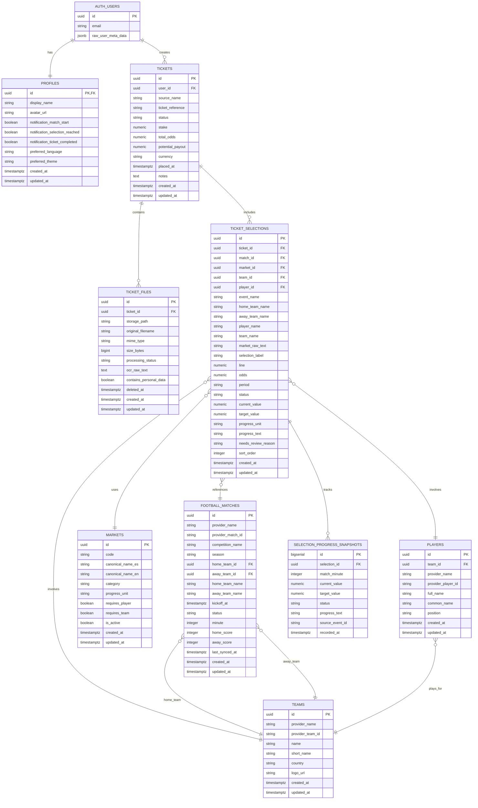

# Esquema de Base de Datos - Ticket Fútbol PWA

## Descripción General

Este documento describe la estructura completa de la base de datos en Supabase para Ticket Fútbol PWA. El diseño sigue los principios de:

- **Privacidad por diseño:** RLS activado en todas las tablas
- **Normalización con contexto histórico:** Los datos del usuario conservan información textual original
- **Separación de responsabilidades:** Tablas de usuario vs catálogos globales
- **Preparación para múltiples proveedores:** No dependencia de API-Football

---

## Índice

1. [Tablas de Usuario](#tablas-de-usuario)
2. [Catálogos Globales](#catálogos-globales)
3. [Relaciones](#relaciones)
4. [Diagrama ER](#diagrama-er)
5. [Row Level Security](#row-level-security)
6. [Storage Privado](#storage-privado)
7. [Flujo de Datos](#flujo-de-datos)
8. [Campos Futuros](#campos-futuros)

---

## Tablas de Usuario

Estas tablas contienen información privada de cada usuario, protegidas por RLS.

### profiles

Información pública y preferencias del usuario.

| Campo | Tipo | Descripción |
|-------|------|-------------|
| id | UUID | Clave primaria, referencia a auth.users |
| display_name | TEXT | Nombre a mostrar |
| avatar_url | TEXT | URL del avatar (nullable) |
| notification_match_start | BOOLEAN | Notificar cuando comience un partido |
| notification_selection_reached | BOOLEAN | Notificar cuando se alcance objetivo |
| notification_ticket_completed | BOOLEAN | Notificar cuando se liquide ticket |
| preferred_language | TEXT | `es` o `en` |
| preferred_theme | TEXT | `system`, `light` o `dark` |
| created_at | TIMESTAMPTZ | Fecha de creación |
| updated_at | TIMESTAMPTZ | Última actualización |

**Trigger:** Se crea automáticamente cuando un usuario se registra en `auth.users`.

---

### tickets

Representa el ticket completo cargado por el usuario.

| Campo | Tipo | Descripción |
|-------|------|-------------|
| id | UUID | Clave primaria |
| user_id | UUID | Usuario propietario |
| source_name | TEXT | Nombre visual de la casa (del pantallazo) |
| ticket_reference | TEXT | Código del ticket (si existe) |
| status | TEXT | Estado actual del ticket |
| stake | NUMERIC(12,2) | Monto apostado |
| total_odds | NUMERIC(10,3) | Cuota total |
| potential_payout | NUMERIC(12,2) | Ganancia potencial |
| currency | CHAR(3) | Moneda (default: COP) |
| placed_at | TIMESTAMPTZ | Fecha de la apuesta |
| notes | TEXT | Notas del usuario |
| created_at | TIMESTAMPTZ | Fecha de creación |
| updated_at | TIMESTAMPTZ | Última actualización |

**Estados permitidos:**
- `draft` - Borrador inicial
- `needs_review` - Requiere revisión manual
- `upcoming` - Próximo (partidos no iniciados)
- `live` - En juego
- `completed` - Completado (resultado pendiente)
- `won` - Ganado
- `lost` - Perdido
- `void` - Anulado
- `archived` - Archivado

**⚠️ IMPORTANTE:** `source_name` es **únicamente información visual** del pantallazo. NO representa ninguna integración con casas de apuestas.

---

### ticket_files

Archivos (pantallazos o PDF) asociados a un ticket.

| Campo | Tipo | Descripción |
|-------|------|-------------|
| id | UUID | Clave primaria |
| ticket_id | UUID | Ticket relacionado |
| storage_path | TEXT | Ruta en Supabase Storage |
| original_filename | TEXT | Nombre original del archivo |
| mime_type | TEXT | Tipo MIME (JPEG, PNG, WebP, PDF) |
| size_bytes | BIGINT | Tamaño del archivo |
| processing_status | TEXT | Estado del procesamiento OCR |
| ocr_raw_text | TEXT | Texto extraído (crudo) |
| contains_personal_data | BOOLEAN | Marca para borrado después de procesar |
| deleted_at | TIMESTAMPTZ | Soft delete |
| created_at | TIMESTAMPTZ | Fecha de creación |
| updated_at | TIMESTAMPTZ | Última actualización |

**Estados de procesamiento:**
- `pending` - Pendiente de subir
- `uploaded` - Subido exitosamente
- `processing` - En procesamiento OCR
- `processed` - Procesado completamente
- `failed` - Fallo en procesamiento
- `deleted` - Borrado (soft delete)

**⚠️ Privacidad:** 
- El archivo NO se almacena en la base de datos, solo su ruta en Storage
- `contains_personal_data = true` marca archivos que deben borrarse después de extraer la información
- Política de retención: Borrar imagen original después de procesamiento exitoso

---

### ticket_selections

Cada selección individual dentro de un ticket.

| Campo | Tipo | Descripción |
|-------|------|-------------|
| id | UUID | Clave primaria |
| ticket_id | UUID | Ticket relacionado |
| match_id | UUID | Partido relacionado (nullable) |
| market_id | UUID | Mercado normalizado (nullable) |
| team_id | UUID | Equipo relacionado (nullable) |
| player_id | UUID | Jugador relacionado (nullable) |
| **Campos históricos textuales** | | |
| event_name | TEXT | Nombre del evento original |
| home_team_name | TEXT | Equipo local (texto original) |
| away_team_name | TEXT | Equipo visitante (texto original) |
| player_name | TEXT | Nombre del jugador (texto original) |
| team_name | TEXT | Nombre del equipo (texto original) |
| market_raw_text | TEXT | Mercado original sin normalizar |
| **Campos de la selección** | | |
| selection_label | TEXT | Etiqueta de la selección |
| line | NUMERIC(10,2) | Línea/Hándicap |
| odds | NUMERIC(10,3) | Cuota de la selección |
| period | TEXT | Período (completo, 1H, 2H, etc.) |
| **Estado y progreso** | | |
| status | TEXT | Estado actual |
| current_value | NUMERIC(12,2) | Valor actual |
| target_value | NUMERIC(12,2) | Valor objetivo |
| progress_unit | TEXT | Unidad de progreso |
| progress_text | TEXT | Mensaje de progreso |
| needs_review_reason | TEXT | Razón de revisión |
| sort_order | INTEGER | Orden visual |
| created_at | TIMESTAMPTZ | Fecha de creación |
| updated_at | TIMESTAMPTZ | Última actualización |

**Estados (compatibles con la UI actual):**
- `upcoming` - Próxima
- `live_tracking` - En seguimiento
- `currently_winning` - Vas ganando
- `target_reached` - Objetivo alcanzado
- `lost` - Perdida
- `finished` - Finalizada
- `void` - Anulada
- `needs_review` - Requiere revisión

**💡 Diseño:** Los campos textuales (`home_team_name`, `away_team_name`, `player_name`, etc.) conservan la información original del ticket, incluso después de normalizar y vincular con IDs de catálogos. Esto previene pérdida de contexto histórico.

---

### selection_progress_snapshots

Historial de progreso en vivo (preparado para uso futuro).

| Campo | Tipo | Descripción |
|-------|------|-------------|
| id | BIGSERIAL | Clave primaria autoincrementable |
| selection_id | UUID | Selección relacionada |
| match_minute | INTEGER | Minuto del partido |
| current_value | NUMERIC(12,2) | Valor en ese momento |
| target_value | NUMERIC(12,2) | Valor objetivo |
| status | TEXT | Estado en ese momento |
| progress_text | TEXT | Mensaje de progreso |
| source_event_id | TEXT | ID del evento fuente |
| recorded_at | TIMESTAMPTZ | Momento del registro |

**⚠️ Todavía no utilizado por la interfaz.** Esta tabla preparará el historial completo del progreso minuto a minuto para análisis posterior.

---

## Catálogos Globales

Estas tablas contienen datos de referencia compartidos entre todos los usuarios. Son de solo lectura para usuarios autenticados.

### teams

Catálogo normalizado de equipos de fútbol.

| Campo | Tipo | Descripción |
|-------|------|-------------|
| id | UUID | Clave primaria |
| provider_name | TEXT | Nombre del proveedor externo |
| provider_team_id | TEXT | ID del equipo en proveedor |
| name | TEXT | Nombre oficial del equipo |
| short_name | TEXT | Nombre corto |
| country | TEXT | País |
| logo_url | TEXT | URL del escudo |
| created_at | TIMESTAMPTZ | Fecha de creación |
| updated_at | TIMESTAMPTZ | Última actualización |

**Constraint:** Unicidad por `(provider_name, provider_team_id)` cuando ambos existen.

---

### players

Catálogo normalizado de jugadores.

| Campo | Tipo | Descripción |
|-------|------|-------------|
| id | UUID | Clave primaria |
| team_id | UUID | Equipo actual (nullable) |
| provider_name | TEXT | Nombre del proveedor externo |
| provider_player_id | TEXT | ID del jugador en proveedor |
| full_name | TEXT | Nombre completo |
| common_name | TEXT | Nombre común |
| position | TEXT | Posición |
| created_at | TIMESTAMPTZ | Fecha de creación |
| updated_at | TIMESTAMPTZ | Última actualización |

**Constraint:** Unicidad por `(provider_name, provider_player_id)` cuando ambos existen.

---

### football_matches

Partidos de fútbol referenciados en tickets.

| Campo | Tipo | Descripción |
|-------|------|-------------|
| id | UUID | Clave primaria |
| provider_name | TEXT | Nombre del proveedor externo |
| provider_match_id | TEXT | ID del partido en proveedor |
| competition_name | TEXT | Nombre de la competición |
| season | TEXT | Temporada |
| home_team_id | UUID | Equipo local normalizado (nullable) |
| away_team_id | UUID | Equipo visitante normalizado (nullable) |
| home_team_name | TEXT | Nombre del equipo local (histórico) |
| away_team_name | TEXT | Nombre del equipo visitante (histórico) |
| kickoff_at | TIMESTAMPTZ | Fecha y hora del partido |
| status | TEXT | Estado actual del partido |
| minute | INTEGER | Minuto actual |
| home_score | INTEGER | Goles local |
| away_score | INTEGER | Goles visitante |
| last_synced_at | TIMESTAMPTZ | Última sincronización |
| created_at | TIMESTAMPTZ | Fecha de creación |
| updated_at | TIMESTAMPTZ | Última actualización |

**Estados del partido:**
- `scheduled` - Programado
- `postponed` - Pospuesto
- `cancelled` - Cancelado
- `first_half` - Primer tiempo
- `halftime` - Medio tiempo
- `second_half` - Segundo tiempo
- `extra_time` - Tiempo extra
- `penalties` - Penales
- `finished` - Finalizado
- `suspended` - Suspendido
- `unknown` - Desconocido

**💡 Diseño:** Los campos `home_team_name` y `away_team_name` se mantienen incluso después de vincular con `home_team_id` y `away_team_id`, para conservar el contexto histórico del ticket original.

---

### markets

Catálogo interno de mercados normalizados.

| Campo | Tipo | Descripción |
|-------|------|-------------|
| id | UUID | Clave primaria |
| code | TEXT | Código único del mercado |
| canonical_name_es | TEXT | Nombre canónico en español |
| canonical_name_en | TEXT | Nombre canónico en inglés |
| category | TEXT | Categoría del mercado |
| progress_unit | TEXT | Unidad de progreso (goals, shots, etc.) |
| requires_player | BOOLEAN | Requiere jugador específico |
| requires_team | BOOLEAN | Requiere equipo específico |
| is_active | BOOLEAN | Mercado activo |
| created_at | TIMESTAMPTZ | Fecha de creación |
| updated_at | TIMESTAMPTZ | Última actualización |

**Mercados iniciales (11):**

| Código | Nombre en español | Categoría | Requiere jugador |
|--------|-------------------|-----------|------------------|
| `match_winner` | Ganador del partido | match_result | No |
| `double_chance` | Doble oportunidad | match_result | No |
| `total_goals` | Total de goles | goals | No |
| `both_teams_to_score` | Ambos equipos marcan | goals | No |
| `handicap` | Hándicap | match_result | No |
| `total_corners` | Total de córners | match_events | No |
| `total_cards` | Total de tarjetas | match_events | No |
| `player_goals` | Goles del jugador | player_stats | Sí |
| `player_shots` | Tiros del jugador | player_stats | Sí |
| `player_shots_on_target` | Tiros al arco del jugador | player_stats | Sí |
| `goalkeeper_saves` | Atajadas del portero | player_stats | Sí |

**Uso:** Este catálogo permite normalizar expresiones equivalentes de diferentes casas de apuestas:
- "Más de 0,5 tiros a puerta"
- "Jugador tendrá 1+ tiro al arco"
- "Over 0.5 shots on target"

Todas se mapean a: `player_shots_on_target`

---

## Relaciones

```
auth.users (1) ──→ (1) profiles
           (1) ──→ (N) tickets

tickets (1) ──→ (N) ticket_files
        (1) ──→ (N) ticket_selections

ticket_selections (N) ──→ (1) football_matches (nullable)
                  (N) ──→ (1) markets (nullable)
                  (N) ──→ (1) teams (nullable)
                  (N) ──→ (1) players (nullable)
                  (1) ──→ (N) selection_progress_snapshots

football_matches (N) ──→ (1) teams (home)
                 (N) ──→ (1) teams (away)

players (N) ──→ (1) teams (nullable)
```

---

## Diagrama ER



---

## Row Level Security

**Todas las tablas tienen RLS activado.**

### Tablas de Usuario

#### profiles
- ✅ SELECT: Usuario puede ver solo su propio perfil
- ✅ UPDATE: Usuario puede actualizar solo su propio perfil
- ❌ INSERT: Creación automática por trigger
- ❌ DELETE: No permitido

#### tickets
- ✅ SELECT: Usuario puede ver solo sus tickets
- ✅ INSERT: Usuario puede crear tickets con su user_id
- ✅ UPDATE: Usuario puede actualizar solo sus tickets
- ✅ DELETE: Usuario puede borrar solo sus tickets

#### ticket_files
- ✅ SELECT: Solo archivos de tickets propios
- ✅ INSERT: Solo en tickets propios
- ✅ UPDATE: Solo archivos de tickets propios
- ✅ DELETE: Solo archivos de tickets propios

#### ticket_selections
- ✅ SELECT: Solo selecciones de tickets propios
- ✅ INSERT: Solo en tickets propios
- ✅ UPDATE: Solo selecciones de tickets propios
- ✅ DELETE: Solo selecciones de tickets propios

#### selection_progress_snapshots
- ✅ SELECT: Solo progreso de selecciones propias
- ❌ INSERT/UPDATE/DELETE: Solo procesos del servidor

### Catálogos Globales

#### teams, players, football_matches, markets
- ✅ SELECT: Todos los usuarios autenticados
- ❌ INSERT/UPDATE/DELETE: Solo procesos internos seguros

---

## Storage Privado

### Bucket: `ticket-uploads`

**Configuración:**
- **Privado:** No accesible públicamente
- **Tamaño máximo:** 10 MiB por archivo
- **Tipos permitidos:** 
  - `image/jpeg`
  - `image/png`
  - `image/webp`
  - `application/pdf`

### Estructura de rutas

```
ticket-uploads/
  └── {user_id}/
      └── {ticket_id}/
          ├── screenshot_1.jpg
          ├── screenshot_2.png
          └── ticket.pdf
```

**Ejemplo:**
```
ticket-uploads/550e8400-e29b-41d4-a716-446655440000/660e8400-e29b-41d4-a716-446655440001/screenshot.jpg
```

### Políticas de Storage

| Operación | Política |
|-----------|----------|
| SELECT | Usuario puede descargar solo archivos de su carpeta |
| INSERT | Usuario puede subir solo a su carpeta |
| UPDATE | Usuario puede modificar solo archivos de su carpeta |
| DELETE | Usuario puede borrar solo archivos de su carpeta |

**⚠️ Seguridad:** La primera carpeta de la ruta DEBE coincidir con `auth.uid()`.

---

## Flujo de Datos

### 1. Registro de usuario
```
Usuario → auth.users
  └─→ Trigger: handle_new_user()
      └─→ profiles (creación automática)
```

### 2. Carga de ticket
```
Usuario sube imagen
  ├─→ Storage: ticket-uploads/{user_id}/{ticket_id}/screenshot.jpg
  ├─→ ticket_files (storage_path, processing_status: 'uploaded')
  └─→ tickets (status: 'draft')
```

### 3. Procesamiento OCR (futuro)
```
Proceso servidor lee ticket_files WHERE processing_status = 'uploaded'
  ├─→ Extrae texto con OCR
  ├─→ Actualiza ticket_files.ocr_raw_text
  ├─→ Actualiza processing_status = 'processed'
  ├─→ Crea ticket_selections (con campos textuales)
  └─→ Actualiza tickets.status = 'needs_review'
```

### 4. Normalización (futuro)
```
Usuario confirma selecciones
  ├─→ Vincula con football_matches
  ├─→ Vincula con markets
  ├─→ Vincula con players/teams
  ├─→ Actualiza tickets.status = 'upcoming'
  └─→ Si contains_personal_data: borra imagen original
```

### 5. Seguimiento en vivo (futuro)
```
Proceso servidor sincroniza estadísticas
  ├─→ Actualiza football_matches (status, minute, scores)
  ├─→ Calcula progreso de ticket_selections
  ├─→ Actualiza current_value, target_value, status
  ├─→ Inserta selection_progress_snapshots
  └─→ Envía notificaciones según preferencias
```

---

## Campos Futuros

Estos campos están preparados pero aún no son utilizados por la interfaz:

### profiles
- `avatar_url` - Futura integración con carga de avatares

### tickets
- `ticket_reference` - Extraído de OCR (si existe)
- `placed_at` - Fecha de la apuesta original (OCR)
- `notes` - Notas privadas del usuario

### ticket_files
- `ocr_raw_text` - Texto crudo extraído (OCR pendiente)
- `contains_personal_data` - Marca para borrado (privacidad)

### ticket_selections
- `match_id`, `market_id`, `team_id`, `player_id` - Normalización pendiente
- `event_name` - Contexto adicional del evento
- `line` - Línea/hándicap (en mercados que aplique)
- `period` - Período del partido
- `needs_review_reason` - Explicación de por qué requiere revisión

### football_matches
- `competition_name` - Competición/liga
- `season` - Temporada
- `last_synced_at` - Control de sincronización

### selection_progress_snapshots
- **Toda la tabla** - Preparada para historial futuro

---

## Decisiones Arquitectónicas

### ¿Por qué campos textuales Y relaciones normalizadas?

**Problema:** Los nombres de equipos y jugadores pueden cambiar, tener traducciones diferentes, o no coincidir exactamente entre:
- Lo que aparece en el pantallazo
- Lo que provee la API de estadísticas
- Lo que está almacenado en catálogos

**Solución:** Almacenar ambos:
1. **Campos textuales** (`home_team_name`, `player_name`, etc.) → Preservan el contexto original del ticket
2. **Relaciones normalizadas** (`home_team_id`, `player_id`, etc.) → Permiten consultas y agregaciones

**Ventajas:**
- No se pierde información histórica si un equipo cambia de nombre
- El ticket siempre se puede mostrar tal como fue creado
- Las estadísticas se pueden actualizar mediante IDs normalizados

### ¿Por qué provider_name es nullable?

El sistema está diseñado para NO depender de un proveedor específico de estadísticas:
- API-Football es **provisional**
- Puede cambiarse a otro proveedor en el futuro
- Pueden coexistir múltiples proveedores
- Los tickets creados manualmente no tendrán proveedor

### ¿Por qué source_name no es una FK?

`source_name` en `tickets` es **solo información visual** del pantallazo. Representa:
- Lo que el usuario ve en su ticket original
- NO una integración técnica
- NO credenciales ni acceso a la casa de apuestas

**Esta aplicación NUNCA se conecta con casas de apuestas.**

---

## Limitaciones Actuales

### No implementado todavía

❌ Proyecto remoto de Supabase  
❌ Ejecución de migraciones  
❌ Autenticación de usuarios  
❌ CRUD de tickets desde la interfaz  
❌ OCR/IA para reconocimiento de pantallazos  
❌ Integración con API de estadísticas  
❌ Sincronización en vivo de partidos  
❌ Cálculo automático de progreso  
❌ Notificaciones push  
❌ Subida de archivos reales  

### Completamente preparado

✅ Estructura completa de tablas  
✅ Relaciones y constraints  
✅ RLS en todas las tablas  
✅ Políticas de storage privado  
✅ Índices para rendimiento  
✅ Triggers para auditoría  
✅ Catálogo de mercados  
✅ Compatibilidad con tipos actuales de la UI  
✅ Documentación completa  

---

## Comandos de Desarrollo

### Generar tipos TypeScript (futuro)
```bash
npx supabase gen types typescript --local > src/types/database.types.ts
```

### Aplicar migraciones locales (cuando Docker esté disponible)
```bash
npx supabase start
npx supabase db reset
```

### Sincronizar con proyecto remoto (cuando exista)
```bash
npx supabase link --project-ref YOUR_PROJECT_REF
npx supabase db push
```

---

## Referencias

- [Supabase RLS Documentation](https://supabase.com/docs/guides/auth/row-level-security)
- [Supabase Storage Documentation](https://supabase.com/docs/guides/storage)
- [PostgreSQL UUID Best Practices](https://www.postgresql.org/docs/current/uuid-ossp.html)
- [ADR-014: Estructura de base de datos](../.github/decisions/technical-decisions.md#adr-014)

---

**Última actualización:** 2026-07-28  
**Versión del esquema:** 1.0.0 (MVP)
